> 本文档 [`Frontmatter`](https://github.com/BTMuli/MuCli#Frontmatter) 由 [MuCli](https://github.com/BTMuli/Mucli) 自动生成于 `2024-04-11 12:06:15`
>
> 更新于 `2026-11-01 12:02:02`

    

# BangumiToday

基于 [Bangumi.tv](https://bangumi.tv) 的桌面番剧应用，聚合 [蜜柑计划](https://mikanani.me)、Comicat 与 [AniBT](https://anibt.net) 的 RSS 资源，并接入 Anime Garden 资源搜索。

从放送日历、热度与评分榜单发现作品，连接 Bangumi 收藏，汇集 RSS 更新，关联本地目录，再用内置播放器继续观看：从发现一部番剧，到整理和播放每一集，都在一个桌面应用里完成。提供条件搜索、RSS 订阅、内置下载、播放记录与系统托盘等功能；内置下载引擎、网络代理设置与原生超分目前仅在 Windows 可用。

> 功能图文展示与在线说明：[MuApp · BangumiToday](https://app.btmuli.ink/docs/BangumiToday/index.html)

版本变更见[更新日志](./CHANGELOG.md)，历史 v0.x 记录见[旧版更新日志](./docs/CHANGELOGS/CHANGELOG-v0.x.x.md)。

## 下载

> 程序已经通过微软商店审核，可以直接在商店下载。

Windows x64 安装包与免安装 ZIP 也可从 [GitHub Releases](https://github.com/BTMuli/BangumiToday/releases/latest) 获取。仓库保留 macOS runner，但尚无 macOS 打包发布流程，功能范围见[贡献指南](./docs/贡献指南.md)。

## 开始使用

按需要完成账号、订阅和网络配置：

1. 浏览放送日历、榜单、条目搜索与资源列表，查找感兴趣的作品。
2. 如需管理收藏与观看进度，在设置中完成 [Bangumi.tv](https://bangumi.tv) 登录授权并同步收藏。授权会跳转 Bangumi 主站。
3. 如需订阅更新并关联本地文件，在 BMF 工作台为番剧配置 RSS 地址与本地目录，也可从首页日历或条目详情搜索资源并订阅。
4. 如需代理，在网络设置（仅 Windows）中选择系统代理或手动 HTTP 代理，修改来源、地址或端口后保存。应用与下载引擎共用这份配置，各自的代理开关独立控制；页面会显示应用代理的实际生效状态，无可用地址时应用请求直连。

## 应用预览

> 这里只放关键界面截图，完整的图文展示见 [MuApp · BangumiToday](https://app.btmuli.ink/docs/BangumiToday/index.html)。

### 发现与管理番剧

按星期浏览 Bangumi 每日放送，查看当季番剧的开播时间、放送话数、评分与收藏热度；也可切换热度与评分排行榜，按年份和月份筛选作品。修仙模式以凌晨 6 点换日，将凌晨放送归入前一日并显示为 `24:00–29:59`。

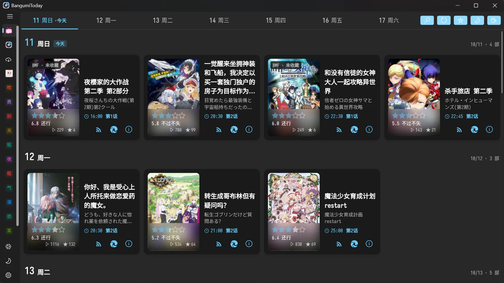

用关键词查找作品，选择排序方式，按条目类型浏览热门标签并组合多个标签，也可调整 NSFW 条件。侧边面板支持按年份、季度或具体日期筛选播出 / 发售日期，并限定评分与排名范围；结果卡片汇总开播信息、评分与收藏热度。

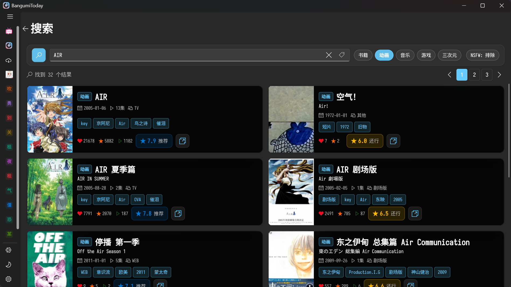

条目详情整合作品简介、评分分布、收藏状态、剧集进度、评论与关联条目。关联作品按分类展示，分类与制作人员职位标题随滚动吸顶；已关联本地文件的作品可直接继续播放。

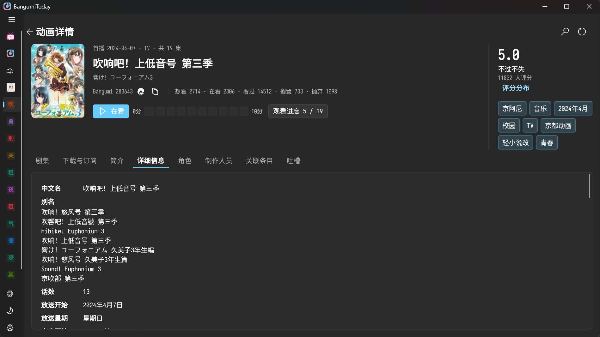

### 收藏与进度

登录 Bangumi 并同步收藏，把想看、在看、看过、搁置与抛弃的作品集中整理，随时修改收藏状态，并查看同步进度。

对照正片与特别篇标记观看进度，查看单集简介、时长与吐槽。

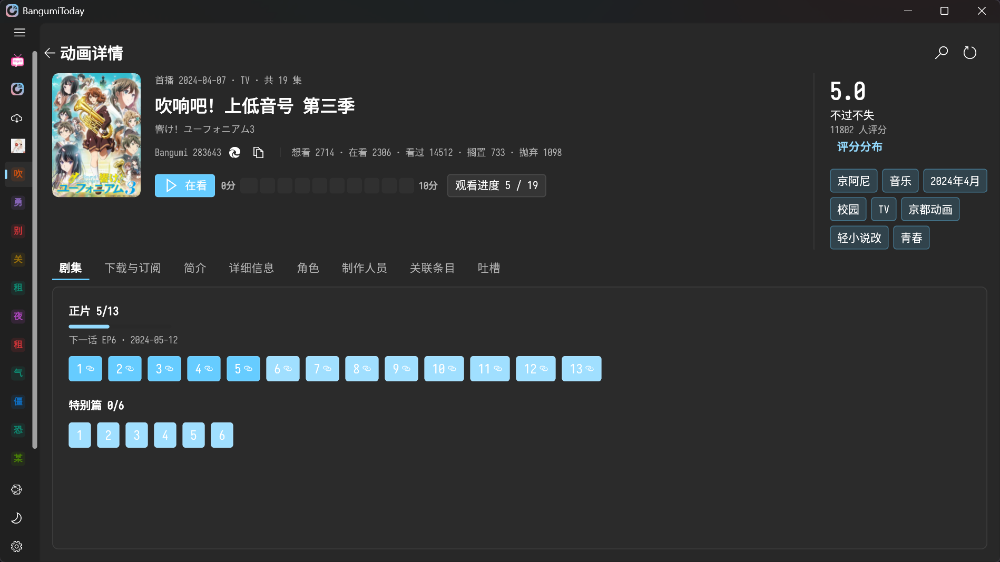

### 订阅与下载

BMF 工作台为番剧关联多个 RSS 订阅与本地目录，封面卡片集中展示放送信息、订阅与目录状态，支持按年份、季度、放送状态与关键词筛选。可并排对照资源和本地文件，切换文件名正序 / 倒序，调整剧集匹配规则，并直接下载或播放；RSS 自动刷新会随放送排期调整检查间隔。

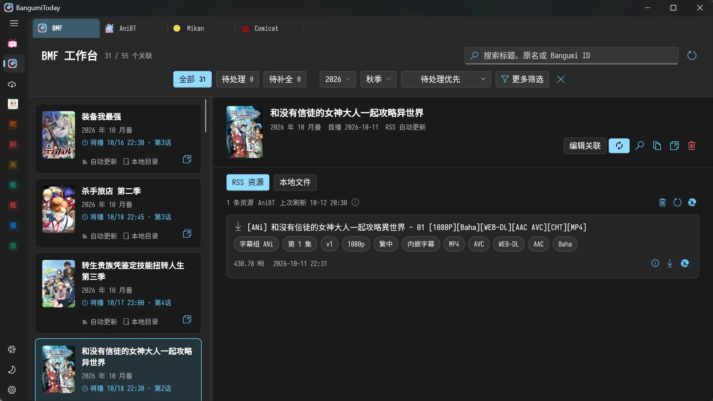

应用聚合 Mikan、Comicat 与 AniBT 的最新资源，可从列表下载种子文件或直接添加到内置下载引擎（Windows）。Mikan 默认使用 `mikanani.kas.pub`，也可切换官方站或自定义镜像。

<table>
  <tr>
    <td width="50%">
      <strong>Mikan</strong> 
      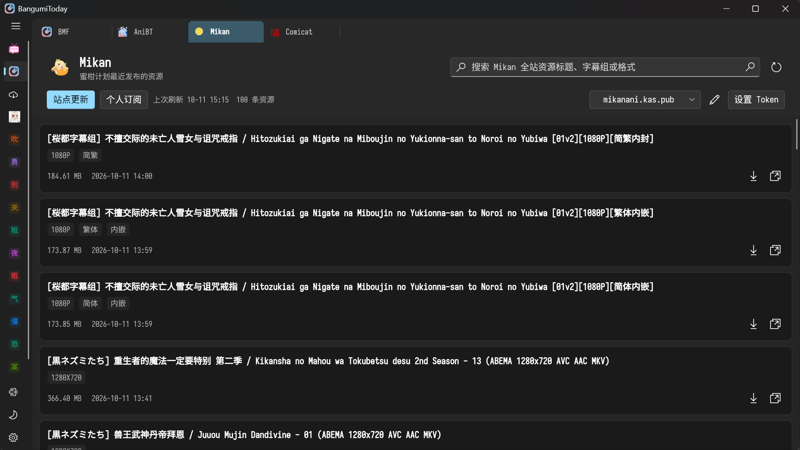
    </td>
    <td width="50%">
      <strong>Comicat</strong> 
      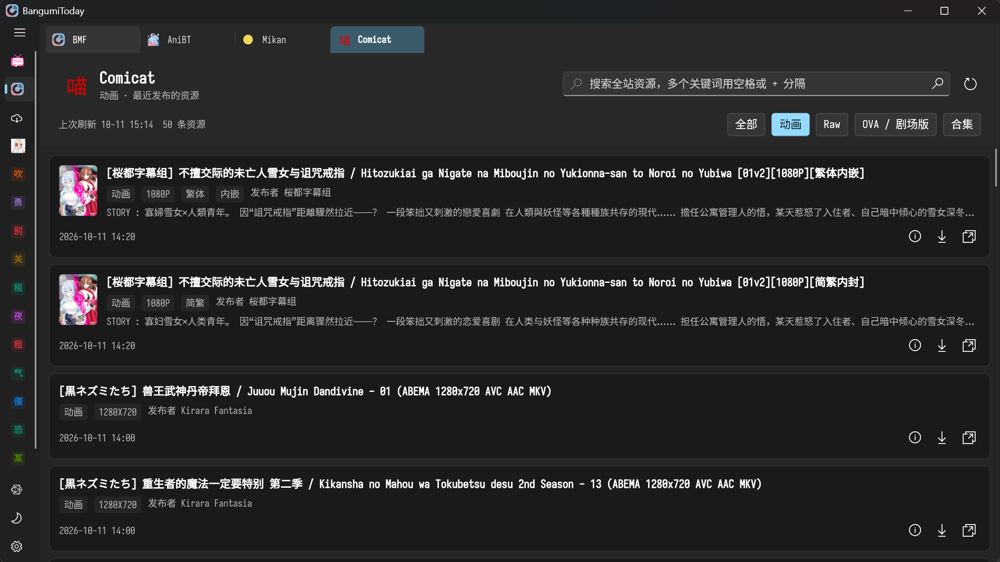
    </td>
  </tr>
  <tr>
    <td colspan="2">
      <strong>AniBT</strong> 
      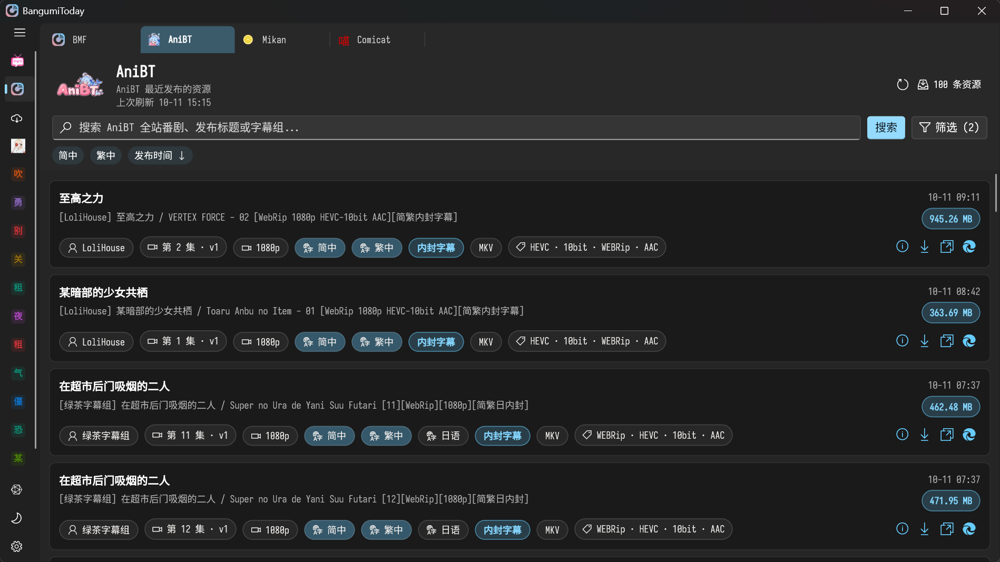
    </td>
  </tr>
</table>

Anime Garden 提供分页资源搜索，支持按类型、字幕组、包含词与排除词筛选；可查看资源介绍、文件清单与磁力链接，并添加到内置下载引擎。

Windows 下载管理页按番剧分组展示任务，支持标题搜索、暂停、按文件选择、手动添加 HTTP / magnet / torrent，以及 Tracker 与限量做种。可搜索并修正任务关联的条目，保存后即时更新分组。

全局、番剧分组与单任务均可查看上传 / 下载速度曲线，任务详情显示单文件下载速度与跨重启保留的累计下载耗时。Tracker 节点图与 Peer 来源关联便于查看连接情况；下载引擎网络诊断提供监听、节点发现和端口映射状态。

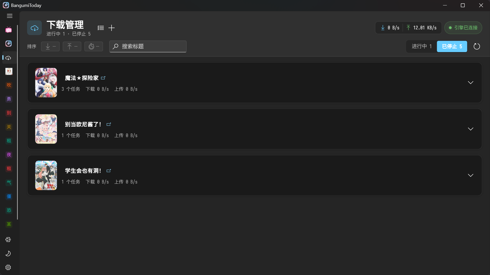

### 视频播放与超分

在独立播放器窗口观看本地视频，按关键词搜索播放记录，结合条目封面、分集记录与续播进度回到上次的位置。用选集列表切换剧集，调整音轨、字幕与播放速度；可按目录递归批量导入多集字幕，切集后自动加载已关联字幕。

关联番剧后可手动标记章节看过，也可在选集面板开启“播放完自动标记完成”。该开关与自动切集独立控制。常用播放操作支持快捷键，按 <kbd>F1</kbd> 查看快捷键面板。

Windows 内置播放器提供 Anime4K 轻量、标准和高质量超分，默认关闭，其中标准档为本项目自定义的中间组合，其余两档取自官方 Mode A。播放 1080p SDR 动画时，在 4K 播放区域选择“高质量”可请求 3840×2160 输出；信息窗显示请求/实际纹理尺寸。高质量使用较大的 CNN 模型，GPU 开销更高；小窗口按实际显示尺寸处理。

AnimeJaNai AI 超分提供“AI 流畅”和“AI 高质量”两档，需要受支持的 NVIDIA 显卡，并在设置中主动安装 TensorRT 组件。安装后预编译常用引擎，其他尺寸首次使用时构建；切换档位期间保留当前生效的超分，待新档位就绪后切换。设置页提供显卡检测与档位推荐。

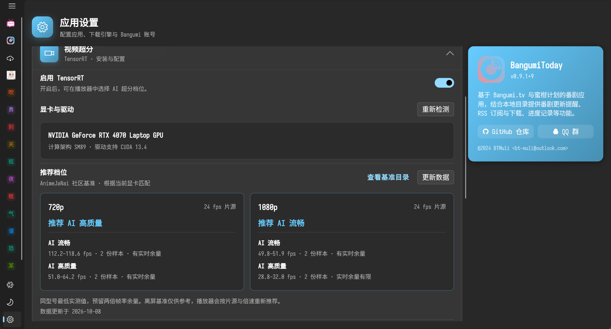

### 个性化与应用配置

在统一设置页中调整主题与主题色，管理缓存与日志，配置下载引擎、Tracker、网络代理与超分组件（仅 Windows），以及 Bangumi 账号与镜像站。Bangumi 的主站、API 与图片镜像可独立选择或自定义，设置页也提供新版接口配置与应用更新检测。

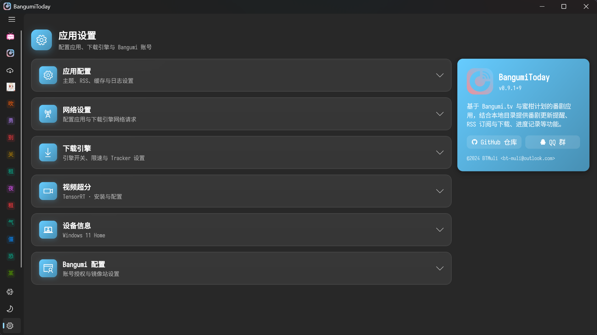

## 主要组件

具体 Dart 包版本以 [`pubspec.yaml`](./pubspec.yaml) 和 `pubspec.lock` 为准；
原生组件以子模块引用、CMake 固定值和推理锁文件为准。

| 组件 | 用途 |
| --- | --- |
| [Anime4K](https://github.com/bloc97/Anime4K) | GLSL 超分着色器 |
| [bt_download](https://github.com/BTMuli/bt_download) | 随 Windows 包提供的 BitTorrent / HTTP 下载引擎 |
| [Drift](https://drift.simonbinder.eu/) | SQLite 数据访问与迁移 |
| [FlChart](https://app.flchart.dev/) | 评分图表与下载传输曲线 |
| [Fluent UI](https://bdlukaa.github.io/fluent_ui/) | Fluent 风格桌面界面 |
| [Hive CE](https://github.com/IO-Design-Team/hive_ce) | 轻量本地状态 |
| [media_kit](https://github.com/media-kit/media-kit) | 播放器、字幕与视频插件 |
| [mpv-AnimeJaNai](https://github.com/the-database/mpv-AnimeJaNai) | Windows 固定 libmpv 分支及 AI 滤镜接入 |
| [Riverpod](https://riverpod.dev/) | 状态管理与依赖注入 |

## 开发与反馈

- 开发环境、源码运行、功能测试与 Windows 打包：[贡献指南](./docs/贡献指南.md) / [Contributing](./CONTRIBUTING.md)。
- 播放器原生接入与推理资源：[Windows playback](./windows/playback/README.md) / [推理资源准备](./windows/playback/inference/README.md)。
- 错误反馈与功能建议：[Issue 模板](https://github.com/BTMuli/BangumiToday/issues/new/choose)；报告时提供应用版本、系统、安装方式和复现步骤。
- 安全漏洞请按[安全策略](./docs/安全策略.md)私下报告；参与交流请遵守[行为准则](./docs/行为准则.md)。

## 参考（按照字典序）

- [Ani](https://github.com/open-ani/ani)
- [AniBT](https://anibt.net)
- [BangumiAPI(doc)](https://bangumi.github.io/api/)
- [BangumiAPI(server)](https://github.com/bangumi/server)
- [BangumiOAuth](https://github.com/bangumi/api/blob/master/docs-raw/How-to-Auth.md)
- [czy0729/Bangumi](https://github.com/czy0729/Bangumi)
- [KNKPAnime](https://github.com/KNKPA/KNKPAnime)
- [mpv-AnimeJaNai](https://github.com/the-database/mpv-AnimeJaNai/)

## Special Thanks（按照字典序）

- [AniBT](https://anibt.net)
- [Anime4k](https://github.com/bloc97/Anime4K)
- [Bangumi.tv](https://bangumi.tv)
- [BangumiData](https://github.com/bangumi-data/bangumi-data)

## 许可

- 项目自有源码采用 [MIT License](./LICENSE)，随包第三方组件保留各自的许可。
- 字体和 Anime4K 着色器的授权文本位于 [`assets/licenses/`](./assets/licenses/)。
- Windows libmpv 当前为 GPL 构建，来源、对应源码和许可见
  [libmpv NOTICE](./windows/licenses/libmpv/NOTICE.md)。
- 推理组件的第三方归属和许可见
  [THIRD_PARTY_NOTICES](./windows/playback/inference/THIRD_PARTY_NOTICES.txt)。
- 下载引擎及其依赖的许可、NOTICE 和 SBOM 随 `bt_download/` runtime 分发。
